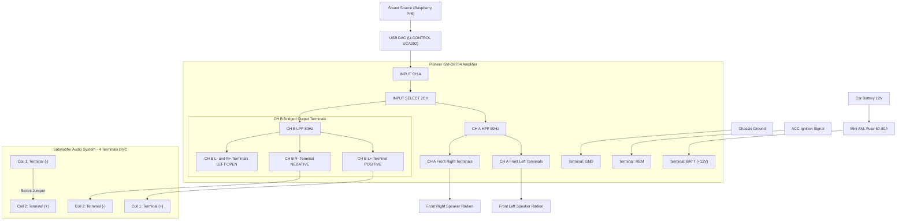
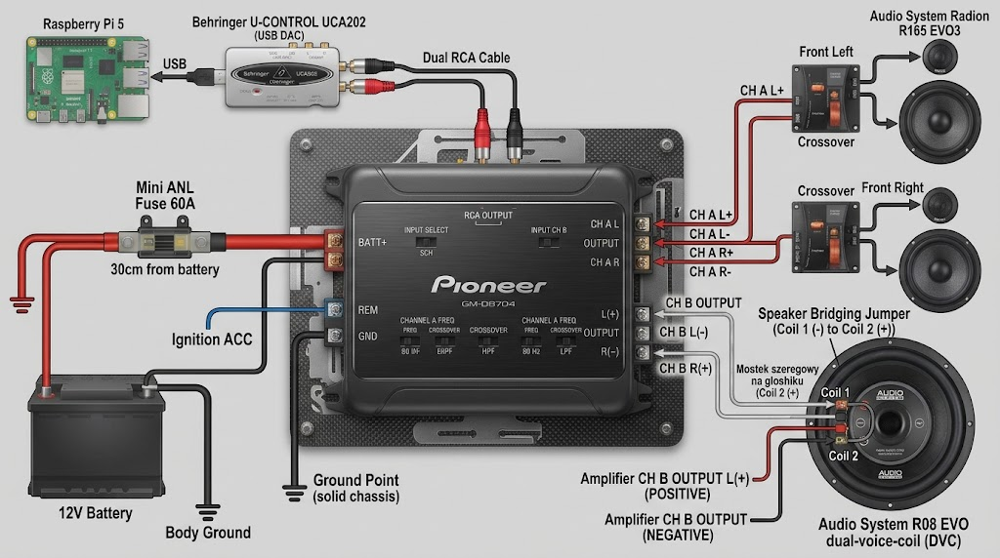

# Head Unit

I have decided to build my own head unit as I want good audio and I also want to collect telmetry while I am driving a car. Notice this project assume you will be collecting telemtry from OB2 compatilbe unit.
This project will also give possablity to use android auto and hands-free system for pickingup callas and making calls.

## Parts

### Computer

1. Raspberry Pi 5 8GB RAM
2. Raspberry Pi Active Cooler
3. RTC JST Battery
4. Waveshare 2-CH CAN FD HAT (Waveshare 17075)
5. Waveshare PCIe to M.2 adapter (Waveshare 26583)
6. Waveshare LCD IPS 7" Screen (Waveshare 11199)
7. Geekworm X1200 Raspberry Pi 5 UPS HAT (Geekworm X1200)
8. SSD M.2 2230 PCIe NVMe 512GB (WESTERN DIGITAL SN530 SDBPTPZ-512G-1012)

### Audio

1. Audio Amplifier (PIONEER GM-D8704)
2. 2x fron speaker + 2x column woofer (Audio System R165 EVO3)
3. 1x subwoofer 20cm 200/280W RMS (Audio System R08 EVO)
4. Microphone usb adapter UGREEN CM477 USB-A - Jack 3.5 mm
5. Behringer U-CONTROL UCA202
6. 2x RCA(male) - RCA(male) wire
7. Microphone (3.5mm audio jack) or cusotm project
   - Microphone 2,2kΩ;Ø9,7x5mm;0,5mA;1÷10V;-24±3dB (PUI AUDIO AOM-5024L-HD-R)
   - Jack 3.5mm male connector with 3 pols (AMPHENOL KS3PC-AU)
   - 3M of wire with 2 vines and good shield (TASKER C114)

### Power section Amplifier

1. M8 Ring Terminal 16mm²
2. Fuse holder Mini-ANL 16mm² + Fuse 80A
3. Wire H01N2-D 16mm² (3m)
4. Wire OFC 2x2.5mm² to connect subwoffer (2m)
5. Wire FLRY-B 1mm² (1m)

### Power section Raspberry Pi

1. M8 Ring Terminal 1.5mm²
2. Sealed fuse holder 1.5mm^2 + Fuse 5A
3. 12V/24V to 5V/5A DC-DC Converter
4. USB-C male connctor
5. UPS Hat with power section for Raspberry Pi 5 (Geekworm X1200)

### Software

1. Raspberry PI OS
2. LIVI Android Auto emulator
3. Python script to control safe shotdown

### Additional parts

1. LiYCY 2x0.34 control cable (to read data from OB2 and send to CAN Hat to Rpi 5)
2. ISO adapter connector for Toyota MR2
3. [OPTIONAL] USB - CAN adapter TJA1051T/3 (needed for testing CAN hat signals)

## How to connect Amplifier

### Instruction step by step

#### **Step 1: Amplifier Power & Control Terminals**

All power cables must be of appropriate gauge to ensure stable operation and safety inside the vehicle.

- **`+12V (BATT)`**: Run a heavy-gauge power wire directly from the car battery. **You must install a Mini ANL fuse (60A–80A)** on this power wire within a maximum distance of 30 cm (12 inches) from the battery terminal.
- **`GND` (Ground)**: Connect a short, heavy-gauge ground wire to a clean, unpainted, solid metal point on the car chassis.
- **`REM` (Remote / Turn-On Signal)**: Connect the turn-on control wire (e.g., to the vehicle's ACC / ignition switch line or system turn-on control output).

---

#### **Step 2: Audio Signal Connection (USB DAC U-CONTROL UCA202 $\rightarrow$ Amplifier)**

Use a single high-quality, dual-shielded RCA (Cinch) cable to connect the audio source to the amplifier:

- **DAC Output**: Connect the RCA cable to the `LINE OUT` jacks (labeled **L** and **R**) on the **Behringer U-CONTROL UCA202** audio interface.
- **Amplifier Input**: Plug the RCA connectors directly into the **`INPUT CH A` (`L` and `R`)** jacks on the Pioneer amplifier panel.
- **`INPUT CH B` Jacks (Left Unused)**: The UCA202 interface only provides one stereo output pair. The audio signal is passed internally to Channel B inside the amplifier by setting the `INPUT SELECT: 2CH` switch in Step 3.
- **`RCA OUTPUT` Jacks (Left Unused)**: These pass-through outputs are only used to chain signal to a second external amplifier, which is not required in this setup.

---

#### **Step 3: Switch & Crossover Configuration**

Set the switches on the amplifier body according to the following specifications for a front component set + subwoofer system:

- **`INPUT SELECT`**: Set to the **`2CH`** position (this is crucial as it internally splits the signal from `CH A` input to all 4 output channels, eliminating the need for external RCA Y-splitters).
- **`CHANNEL A` (Front Speakers)**: Set the crossover switch to **`HPF`** (High-Pass Filter), and set the frequency dial (`FREQ`) to approximately **80 Hz** (protects the front door speakers from reproducing low bass frequencies).
- **`CHANNEL B` (Subwoofer)**: Set the crossover switch to **`LPF`** (Low-Pass Filter), and set the frequency dial (`FREQ`) to approximately **80 Hz** (ensures only low frequencies are sent to the subwoofer).

---

#### **Step 4: Connecting Front Speakers – Section A (Stereo)**

The front component set (Audio System Radion R165 EVO3) is powered in standard stereo mode via Channel A:

- **Left Channel**: Connect the speaker wires from the left crossover network to the **`CH A (L+)`** and **`CH A (L-)`** terminals on the amplifier.
- **Right Channel**: Connect the speaker wires from the right crossover network to the **`CH A (R+)`** and **`CH A (R-)`** terminals on the amplifier.

---

#### **Step 5: Connecting & Bridging the Subwoofer – Section B (Bridged)**

The dual-voice-coil (DVC) subwoofer (Audio System R08 EVO) requires a series voice-coil connection and bridged amplifier wiring to present a safe $4\,\Omega$ load to the amplifier:

1. **Subwoofer Voice Coil Wiring (Series Connection):**

   - Connect a short jumper wire between **Coil 1 (-)** terminal and **Coil 2 (+)** terminal directly on the subwoofer terminal block.

2. **Amplifier-to-Subwoofer Wiring:**

   - Connect the wire from the **`CH B (L+)`** amplifier terminal to the open **Coil 1 (+)** terminal on the subwoofer.
   - Connect the wire from the **`CH B (R-)`** amplifier terminal to the open **Coil 2 (-)** terminal on the subwoofer.

3. **`CH B (L-)` and `CH B (R+)` Terminals (Left Unused)**: In bridged mode, the amplifier draws power exclusively from the outer terminals (`L+` and `R-`), leaving the inner Channel B terminals unconnected.

### High level schema (Mermaid)



### High level schema (Plain)

```plaintext
[ CAR BATTERY 12V ]
       │
       ├──( 1. Main power cable + Fuse 60-80A )──────────────────────────────┐
       │                                                                      ▼
       └──( 2. 12V power supply to the system )                         [ PIONEER GM-D8704 AMPLIFIER ]
              │                                                        • [ +12V ] (BATT)
              ▼                                                        • [ GND ]  (Chassis Ground)
        [ BUCK CONVERTER 12V -> 5V/5A ]                                        • [ REM ]  (ACC / Ignition signal)
               │                                                                      │
               └──( Stable 5V / 5A output )                                           │
                      │                                                               │
                      ▼                                                               │
        [ GEEKWORM X1200 UPS HAT + SANYO BATTERIES ]                                  │
               │                                                                      │
               └──( Vertical power via Pogo-pins )                                    │
                      │                                                               │
                      ▼                                                               │
        [ RASPBERRY PI 5 + NVMe SSD + CAN HAT ]                                       │
               │                                                                      │
               └──( USB audio data transfer )                                         │
                      │                                                               │
                      ▼                                                               │
        [ USB DAC (PCM5102A) ]                                                        │
               │                                                                      │
               └──( RCA Cable: L and R Channels ) ────────────────────────────────────► [ INPUT CH A (L / R) ]
                                                                                      [ INPUT CH B ] (Left empty)
                                                                                              │
                                                            ┌─────────────────────────────────┴─────────────────────────────────┐
                                                            ▼                                                                   ▼
                                                [ CH A OUTPUT SECTION ]                                             [ CH B OUTPUT SECTION ]
                                                • Setting: HPF @ 80 Hz                                              • Setting: LPF @ 80 Hz
                                                • CH A (L+ / L-) ──► Front Left Speaker                             • CH B (L+)  ──► Subwoofer (+)
                                                • CH A (R+ / R-) ──► Front Right Speaker                            • CH B (R-)  ──► Subwoofer (-)
                                                                                                                        (CH B: L- and R+ left open)
```

### High level schema (Picture)


>This picture was generated by AI 

## How to connect Computer

### Instruction step by step

### High level schema (Mermaid)

### High level schema (Plain)

```
[CAR BATTERY]
      │
      ▼
[MAIN ISOLATOR SWITCH]
      │
      ├──> [5A FUSE]
      │         │
      │         ▼
      │    [RELAY PIN 30][cite: 1, 2]
      │         │ (IGN On)
      │         ▼
      │    [RELAY PIN 87][cite: 1, 2]
      │         │
      │         ▼
      │    [DC-DC 12V->5V]
      │         │ (USB-C)
      │         ▼
      │    [GEEKWORM UPS]
      │         │
      │         ▼
      │    [RASPBERRY PI 5]
      │    ├── [NVMe HAT + SSD]
      │    ├── [CAN Bus HAT]
      │    ├── [RTC Battery]
      │    └── [USB Ports]
      │          ├── [Unitek Y-247A] ──> [Amphenol Mic (TRS)]
      │          └── [Behringer UCA202] ──> [RCA] ──> [Car Amp]
      │
      ├──> [RELAY PIN 86 (IGN)][cite: 1, 2]
      │
      └──> [RELAY PIN 85 (GND)][cite: 1, 2] ──> [CAR BODY]
```

### High level schema (Pucture)