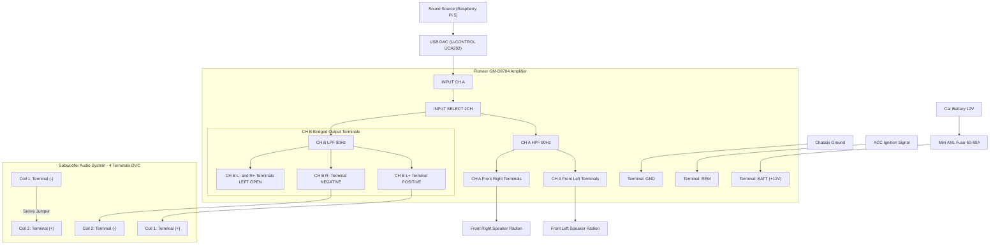

# Head Unit

I have decided to build my own head unit as I want good audio and I also want to collect telmetry while I am driving a car. Notice this project assume you will be collecting telemtry from OB2 compatilbe unit.
This project will also give possablity to use android auto and hands-free system for pickingup callas and making calls

## Parts

### Computer

1. Raspberry Pi 5 8GB RAM
2. Raspberry Pi Active Cooler
3. RTC JST Battery
4. Waveshare 2-CH CAN FD HAT (Waveshare 17075)
5. Waveshare PCIe to M.2 adapter (Waveshare 26583)
6. Waveshare LCD IPS 7" Screen (Waveshare 11199)
7. SSD M.2 2230 PCIe NVMe 512GB (WESTERN DIGITAL SN530 SDBPTPZ-512G-1012)

### Audio

1. Audio Amplifier (PIONEER GM-D8704)
2. 2x fron speaker + 2x column woofer (Audio System R165 EVO3)
3. 1x subwoofer 20cm 200/280W RMS (Audio System R08 EVO)
4. Microphone usb adapter UGREEN CM477 USB-A - Jack 3.5 mm
5. Behringer U-CONTROL UCA202
6. 4x RCA(male) - RCA(male) wire
7. Microphone (3.5mm audio jack) or cusotm project
   - Microphone 2,2kΩ;Ø9,7x5mm;0,5mA;1÷10V;-24±3dB (PUI AUDIO AOM-5024L-HD-R)
   - Jack 3.5mm male connector with 3 pols (AMPHENOL KS3PC-AU)
   - 3M of wire with 2 vines and good shield (TASKER C114)

### Power section Amplifier

1. M8 Ring Terminal 16mm²
2. Fuse holder Mini-ANL 16mm² + Fuse 50A
3. Wire H01N2-D 16mm² (3m)
4. Wire OFC 2x2.5mm² to connect subwoffer (2m)
5. Wire FLRY-B 1mm²

### Power section Raspberry Pi

1. ISO adapter connector for Toyota MR2
2. Sealed fuse holder 1.5-2.5mm^2 + Fuse 5-7.5A
3. 12V 30A JD1914 automotive relay with 30A fuse
4. Few 0.25W 120Ω resistors
5. PC817 1-Channel Optoisolator Module 12V
6. 12V/24V to 5V/5A DC-DC Converter
7. USB-C male connctor

### Software

1. Raspberry PI OS
2. LIVI Android Auto emulator
3. Python script to control safe shotdown

### Additional parts

1. LiYCY 2x0.34 control cable (to read data from OB2 and send to CAN Hat to Rpi 5)
2. ISO adapter connector for Toyota MR2
3. [OPTIONAL] USB - CAN adapter TJA1051T/3 (needed for testing CAN hat signals)

## How to connect Amplifier

### Instruction step by step

### High level schema (Mermaid)



### High level schema (Plain)

```plaintext
[ CAR BATTERY 12V ]
       │
       ├──( 1. Main power cable + Fuse 60-80A )──────────────────────────────┐
       │                                                                      ▼
       └──( 2. 12V power supply to the system )                         [ PIONEER GM-D8704 AMPLIFIER ]
              │                                                        • [ +12V ] (BATT)
              ▼                                                        • [ GND ]  (Chassis Ground)
        [ BUCK CONVERTER 12V -> 5V/5A ]                                        • [ REM ]  (ACC / Ignition signal)
               │                                                                      │
               └──( Stable 5V / 5A output )                                           │
                      │                                                               │
                      ▼                                                               │
        [ GEEKWORM X1200 UPS HAT + SANYO BATTERIES ]                                  │
               │                                                                      │
               └──( Vertical power via Pogo-pins )                                    │
                      │                                                               │
                      ▼                                                               │
        [ RASPBERRY PI 5 + NVMe SSD + CAN HAT ]                                       │
               │                                                                      │
               └──( USB audio data transfer )                                         │
                      │                                                               │
                      ▼                                                               │
        [ USB DAC (PCM5102A) ]                                                        │
               │                                                                      │
               └──( RCA Cable: L and R Channels ) ────────────────────────────────────► [ INPUT CH A (L / R) ]
                                                                                      [ INPUT CH B ] (Left empty)
                                                                                              │
                                                            ┌─────────────────────────────────┴─────────────────────────────────┐
                                                            ▼                                                                   ▼
                                                [ CH A OUTPUT SECTION ]                                             [ CH B OUTPUT SECTION ]
                                                • Setting: HPF @ 80 Hz                                              • Setting: LPF @ 80 Hz
                                                • CH A (L+ / L-) ──► Front Left Speaker                             • CH B (L+)  ──► Subwoofer (+)
                                                • CH A (R+ / R-) ──► Front Right Speaker                            • CH B (R-)  ──► Subwoofer (-)
                                                                                                                        (CH B: L- and R+ left open)
```